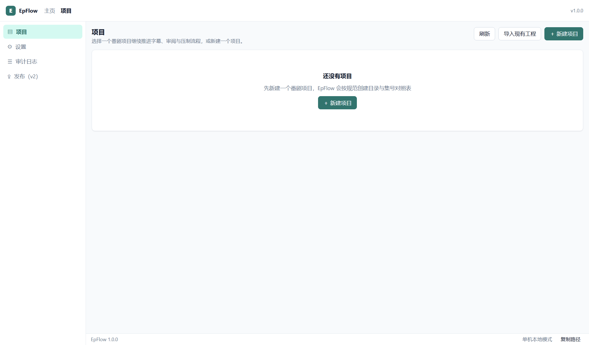
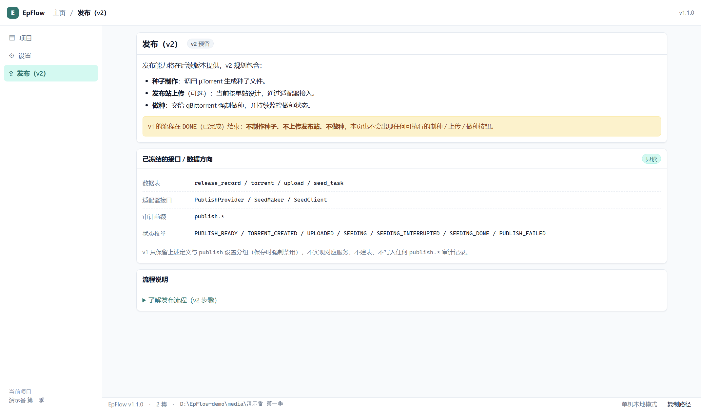

# EpFlow · 番剧流程规范化软件

把「建目录 → 套模板 → 字幕双审 → 章节 → OKEGui 压制 → 合并章节 → 转 MP4 → 按发布名重命名」固化为一条**状态驱动、门禁强制、可审计**的本地生产线。

- 平台：Windows 10 21H2+ / Windows 11（x64）
- 形态：**Electron 桌面应用，交付 exe**（NSIS 安装版 + 便携版）
- 语言：TypeScript（主进程 + 渲染层同语言）
- 数据：本地 JSON 状态库（原子写）+ JSONL 审计，无云端、无数据库服务

---

## 一、交付物

| 产物 | 位置 | 说明 |
|---|---|---|
| 安装版 | `release\EpFlow-1.0.0-Setup.exe` | 每用户安装、免管理员、可改安装目录、建快捷方式 |
| 便携版 | `release\EpFlow-1.0.0-portable.exe` | 单文件双击即用 |
| 绿色 zip 版 | `release\EpFlow-1.0.0-x64.zip` | **解压即用，不写临时目录**；安装器报临时文件错误时用这个 |
| 绿色目录版 | `release\win-unpacked\EpFlow.exe` | 调试/直接运行 |

---

## 二、界面预览

| 项目列表 | 发布（v2 占位） |
|---|---|
|  |  |

> 截图由打包后的 exe 以 `--smoke --shots=<dir>` 自动捕获（无人工介入），见 §九。

## 三、开发与构建
```powershell
# 依赖（已安装则跳过）
npm install

# 开发（Vite + Electron，热更新）
npm run dev

# 类型检查 / 单元测试
npm run typecheck
npm run test

# 构建产物（dist/main、dist/renderer）
npm run build

# 打包 exe（安装版 + 便携版）
npm run dist

# 只打便携版
npm run dist:portable
```

打包使用 `electron-builder`，配置见 `electron-builder.yml`；图标由 `scripts/make-icon.py` 生成（Pillow），产物在 `release/`。

> 网络受限时先设置镜像：`$env:ELECTRON_MIRROR='https://npmmirror.com/mirrors/electron/'`、`$env:ELECTRON_BUILDER_BINARIES_MIRROR='https://npmmirror.com/mirrors/electron-builder-binaries/'`。

---

## 四、首次使用

1. 启动 EpFlow → 在「设置」里确认**素材根目录**（默认 `C:\EpFlow\materials`）与外部工具路径。
2. 「项目 → 新建项目」：填番名、发布名（软件会自动识别并高亮集数位，点选确认）、总集数、基准发布集数。
3. 目录预览确认后创建；进入项目页 →「模板与实例化」上传该番的 `json` / `vpy` 模板，预览差异后一键实例化到全部集。
4. 每集：导入字幕 → AI 审阅 → 处理问题 → 人工审阅通过 → 生成章节 → 章节锁定 → 压制 → 合并 → 转码选择 → 命名 → 完成。
5. 顶部「审计日志」可查完整时间线并导出 CSV。

---

## 五、目录与数据

项目目录（`{素材根}\{番名}`）内由本软件维护的文件：

```
{番名}\
├─ project.json                 # 可读快照（自动生成）
├─ episodes.json                # 集号与状态快照（自动生成）
├─ .epflow\
│  ├─ state.json                # 真正的状态库（原子写，带 .bak）
│  ├─ audit.jsonl               # 追加式审计流水
│  ├─ prompts\                  # 生成的 AI 审阅 prompt
│  └─ raw\                      # 粘贴导入的原始 AI 返回
├─ .templates\source.json|vpy   # 模板库
├─ [翻译用]\01\{工作名}.ass     # 字幕工作副本（导入时规范化）
├─ 01\{工作名}.json|.vpy        # 实例化产物
├─ 01\output\                   # OKEGui 成品与最终文件
└─ 01\{工作名}.chapters.xml     # 锁定章节
```

应用级数据（`%APPDATA%\EpFlow\`）：`settings.json`、`app-state.json`、`logs\epflow-YYYYMMDD.log`（保留 14 天）、窗口状态。

> 状态库是唯一真相；快照 JSON 仅供阅读与外部工具使用。状态变更与审计在同一事务内落盘。

---

## 六、门禁与状态机

主流程状态：`INIT → TEMPLATE_READY → SUB_IMPORTED → AI_REVIEWING → AI_PASSED → HUMAN_REVIEWING → HUMAN_PASSED → CHAPTER_DRAFT → CHAPTER_LOCKED → ENCODING → ENCODED → CHAPTER_MERGED → (MP4_DONE) → NAMED → DONE`

硬规则：

- AI 未通过（存在未处理的 blocker/major）→ 人工审阅按钮禁用。
- 人工通过后才允许生成章节；章节锁定后才允许压制。
- 字幕哈希变化 → AI 结论、人工通过、章节全部失效，状态回退 `SUB_IMPORTED`，压制被阻断。
- 章节 XML 被外部修改 → 哈希不符，合并被阻断。
- 同一时间只允许一集处于 `ENCODING`。
- 强制通过 AI 需在设置中显式开启 `allowForcePass`，并逐条填豁免理由，全部留痕。

---

## 七、外部工具

| 工具 | 用途 | 缺失时 |
|---|---|---|
| OKEGui | 压制（只启动 GUI，不自动化界面） | 阻断压制，引导设置路径 |
| ffmpeg / ffprobe | 转 MP4、媒体信息与章节校验 | 阻断转码/校验，其余可用 |
| MKVToolNix（mkvpropedit / mkvmerge） | 写章节 / 回退合并 | 阻断合并（需安装 MKVToolNix v97+，软件自动探测） |
| Aegisub | 人工审阅打开字幕 | 回退系统默认程序 |
| mpv | 可选预览 | 使用内置播放器 |
| Python | vpy 语法校验（可选） | 跳过校验并提示 |
| DSH（或 OpenAI 兼容接口） | AI 审阅 | 可用「粘贴 JSON」模式 |

工具路径在「设置 → 外部工具」探测或手动指定，支持一键探测填充。

---

## 八、AI 审阅的三种模式

| 模式 | 说明 |
|---|---|
| `paste`（默认） | 软件生成 prompt 并复制到剪贴板 → 在 DSH 中审阅 → 把返回 JSON 粘回软件。无需任何命令行/接口。 |
| `http` | 任何 OpenAI 兼容 `/chat/completions` 接口。API Key 只从环境变量读取（默认 `DEEPSEEK_API_KEY`），不写入配置文件。 |
| `cli` | 本机有 `dsh` 命令行时直接调用，参数模板可配（`{promptFile}`、`{model}`）。 |

无论哪种模式，返回结果都会经过 zod Schema 校验；解析失败会保留原文与错误，可用「粘贴结果」手工修正后重试。

---

## 九、源码结构

```
src/
├─ main/                 # Electron 主进程
│  ├─ index.ts           # 单实例、窗口、菜单、冒烟自检
│  ├─ ipc/               # 类型化 IPC + zod 校验 + 错误信封
│  ├─ services/          # project/template/subtitle/review/human/chapter/
│  │                     # gate/encode/mux/transcode/naming/audit/watch
│  ├─ integrations/      # dsh-client / tools / process-runner / ffprobe
│  ├─ store/             # repository(JSON 状态库) / atomic / settings
│  └─ util/              # logger / hash / paths / encoding
├─ preload/              # contextBridge（渲染层无 Node 权限）
├─ shared/               # 纯函数：状态机、release-name、template-vars、
│                        # ass-parser、chapter-builder、filename、diff、time
└─ renderer/             # React 19 + 自建设计系统
   ├─ pages/             # ProjectList / Wizard / ProjectHome / Workbench / Settings / Audit / Publish
   ├─ components/        # ui / VTable / ReviewPanel / ChapterPanel / EncodePanel / TemplatePanel
   └─ styles/            # tokens.css + app.css（严格按需求 §8.5 设计 token）
```

---

## 十、测试

```powershell
npm run test        # vitest：纯函数单测 + 主流程集成测试（不依赖真实 ffmpeg/OKEGui）
```

- `tests/shared.test.ts`：发布名识别、变量引擎、ASS 解析、文件名、时间码、diff。
- `tests/chapter-builder.test.ts`：章节算法与 Matroska XML。
- `tests/integration.test.ts`：初始化 → 导入字幕 → AI 结果入库 → 人工通过 → 章节锁定 → 门禁阻断 → 命名预览 → 字幕变更级联失效。\n- `tests/pipeline.test.ts`：**真实 ffmpeg + MKVToolNix** 跑通「成品识别 → 章节合并（mkvpropedit）→ 转 MP4（章节保留）→ 发布名重命名 → 完成」，并校验章节数、首章 0、时长差 ≤1s。

无界面冒烟（构建验证）：

```powershell
$env:ELECTRON_RUN_AS_NODE=$null
.\release\win-unpacked\EpFlow.exe --smoke --smoke-out="%TEMP%\epflow-smoke.json"
```

---

## 十一、v1 范围与 v2 预留

- v1 到 `DONE` 结束；「发布（v2）」为说明页，不含任何可执行操作。
- 已冻结的扩展方向：`release_record / torrent / upload / seed_task` 数据模型、`PublishProvider / TorrentMaker / SeedClient` 接口、`publish.*` 审计前缀、`PUBLISH_* / SEEDING_*` 状态枚举。
- v2 计划：μTorrent 制种 → 发布站上传（可选、当前单站）→ qBittorrent 强制做种。

---

## 十二、已知简化

| 项 | 现状 |
|---|---|
| 模板 L3 手工字段映射 | 提供替换项勾选与自定义替换、diff 预览；未做独立字段映射表编辑器 |
| 查找替换 | 服务端已实现并有测试，工作台暂未接入按钮（外部编辑器改完会自动失效审阅） |
| 批量操作 | 以集为粒度；模板实例化支持批量；v1 一次只允许一集压制 |
| 章节时间轴 | 拖动条为相对比例，精确时间以表格输入为准（吸附 0.5s） |
| 视频预览 | 取模板 `InputFiles[0]`；模板未实例化时降级为纯字幕审阅 |
| 数字签名 | 未签名，首次运行需 SmartScreen 放行 |

---

## 十三、常见问题

| 现象 | 处理 |
|---|---|
| 首次运行被 SmartScreen 拦截 | 未做代码签名，点「更多信息 → 仍要运行」；正式分发建议购买签名证书 |
| 安装时报 NSIS Error: Error writing temporary file | 这是 NSIS 安装器写 `%TEMP%` 失败（临时目录不可写/被清理/杀软拦截/磁盘满），**不是安装包损坏**。优先改用 `EpFlow-1.0.0-x64.zip`（解压即用）；仍想安装时：① echo %TEMP% 确认目录存在且可写，必要时 `set TEMP=%LOCALAPPDATA%\Temp` 后重新运行；② 把安装包放到本地磁盘（不要在网络盘/压缩包内直接运行）；③ 暂时关闭杀软实时防护或以普通用户运行 |
| 压制按钮一直灰 | 看「压制」页的门禁清单，逐项处理（模板/AI/人工/章节/哈希/源视频） |
| 找不到成品 | 用「重新扫描成品」或「手动指定」；OKEGui 输出目录必须在集目录的 `output\` 下 |
| 合并失败 | 检查 MKVToolNix 路径、文件是否被播放器占用；失败会自动回滚备份 |
| 字幕改了但状态没变 | 软件在运行时会监视 `[翻译用]` 与集目录；也可重新导入会强制失效 |
| AI 审阅报 DSH 不可用 | 切换到「粘贴 JSON」模式，或配置 HTTP 接口与环境变量 |

---

## 十三、文档

- 需求与设计：`需求与设计文档（项目外部）`
- 开发任务拆解：`docs/01-开发任务拆解-v1.0.md`
