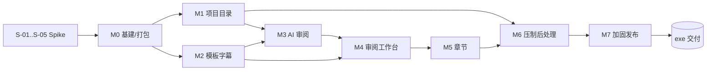

# EpFlow v1.0 · 开发任务拆解

> 依据：`需求与设计文档（项目外部）`（v0.3 草案）
> 交付形态：**Windows 桌面 exe**（安装版 + 便携版）
> 本文档版本：1.0.0 ｜ 编写日期：2026-10-19

---

## 0. 摘要

| 项目 | 结论 |
|---|---|
| 产品代号 | **EpFlow**（中文名「番流」，可随时改名，只影响 exe 名称与图标） |
| 技术栈 | **TypeScript + Electron 40 + React 19 + Vite 7 + esbuild**，零原生模块 |
| 交付物 | `EpFlow-1.0.0-Setup.exe`（NSIS，每用户安装）+ `EpFlow-1.0.0-portable.exe`（免安装单文件） |
| 源码位置 | `EpFlow 项目根目录\`（独立工程目录，与需求文档同级） |
| 任务规模 | 77 个任务 / 约 **114.5 人日**（纯手写口径）；AI 辅助流水线开发建议按 **6–8 周** 排 |
| v1.0 必做范围 | FR-01 ~ FR-15、§6 状态机与门禁、§8 界面、§9 异常、§10 非功能、§11.1 ~ §11.11 验收、§12.1 发布预留 |
| v1.0 不做 | 种子制作、发布站上传、做种（v2）、多人协作、字幕翻译/打轴、OKEGui 界面自动化 |

**相对设计文档的三处工程决策（已定，理由见 §2.3）**

1. 桌面壳选 **Electron**（文档 §7.8 推荐）而非 Tauri/C#：本机无 Rust/.NET SDK，且项目 90% 的复杂度在文件系统、子进程与数据表格 UI 上，Node 侧能力最完整。
2. 状态持久化用 **JSON 状态库（原子写 + JSONL 审计 + 快照）** 替代 SQLite：避免原生模块编译/打包风险（本机无 MSVC 构建链），单机单用户规模（百集级）完全够用；`Repository` 接口隔离，后续可换 SQLite。
3. `[翻译用]` 子目录名 **可配置**：文档写死 `[翻译用]`（含方括号），实测存量工程 `Ao Ashi S2\翻译用` 不带方括号。默认 `[翻译用]`，向导与导入时自动识别已有写法。

---

## 1. 交付形态（exe）

### 1.1 产物

| 产物 | 生成命令 | 用途 | 体积预估 |
|---|---|---|---|
| `EpFlow-1.0.0-Setup.exe` | `npm run dist` | NSIS 安装器，每用户安装（免管理员），可选安装目录，建桌面/开始菜单快捷方式，卸载保留用户数据 | 90–120 MB |
| `EpFlow-1.0.0-portable.exe` | `npm run dist:portable` | 单文件便携版，双击即用，数据写 `%APPDATA%\EpFlow` | 90–120 MB |
| `EpFlow-1.0.0-win-x64.zip` | `--dir` 打包后压缩 | 绿色目录版（可选，给极客用户） | 200 MB 解压后 |

> 体积来源为 Chromium 运行时，属 Electron 固有成本；v1.0 不做体积优化（文档 §7.8 已确认优先跑通流程）。

### 1.2 运行环境

- Windows 10 21H2+ / Windows 11，x64。
- 无 Node、无 Python、无 .NET 运行时依赖（全部随 exe 打包）。
- 外部工具按需：OKEGui、ffmpeg/ffprobe、MKVToolNix、Aegisub、mpv、DSH（AI 审阅）。缺失时对应功能给明确引导，不阻塞其余流程（§7.7）。
- 除 AI 审阅外**全离线可用**（§10）。

### 1.3 数据与日志落点

| 内容 | 位置 |
|---|---|
| 应用设置、工具路径、窗口状态 | `%APPDATA%\EpFlow\settings.json` |
| 全局项目索引（最近项目列表） | `%APPDATA%\EpFlow\app-state.json` |
| 运行日志（按天滚动，保留 14 天） | `%APPDATA%\EpFlow\logs\epflow-YYYYMMDD.log` |
| 诊断包（日志 + 脱敏设置 + 状态摘要） | 用户主动导出 zip |
| 项目状态库（每个项目一份） | `{项目根}\.epflow\state.json`（原子写 + `.bak` 轮换） |
| 项目审计流水 | `{项目根}\.epflow\audit.jsonl`（只追加） |
| 可读快照（文档要求） | `{项目根}\project.json`、`{项目根}\episodes.json` |
| 合并前备份 | `{成品}.before-chapters.mkv`（可配置保留） |
| 重命名冲突旧文件 | `{输出目录}\_trash\{时间戳}\` |

> 设计文档 §7.3 要求 SQLite，本版以 JSON 状态库实现同一套字段与事务语义（单文件原子替换 = 事务），字段名保持与 SQL 草案一一对应，便于未来迁移。

### 1.4 exe 验收清单（对应 §11 + 打包维度）

- [ ] 干净 Win10 21H2 / Win11 机器双击安装器可完成安装，无需管理员权限。
- [ ] 安装版与便携版功能一致；便携版在只读盘符外的任意路径可运行。
- [ ] exe 文件属性含产品名 EpFlow、版本 1.0.0.0、版权与图标（16/32/48/256）。
- [ ] 卸载后 `%APPDATA%\EpFlow` 保留（提示用户可手动清理），无残留注册表垃圾。
- [ ] 首次启动向导：素材根目录、工具路径探测结果、操作者名称；全部可跳过。
- [ ] 界面在 100% / 125% / 150% DPI 下不糊、不溢出；1280×720 最小窗口可用。
- [ ] 中文路径、空格路径、`[方括号]` 路径、>260 字符长路径均可正常工作。
- [ ] 无网络启动不报错；AI 审阅按钮给出“DSH 不可用”的可读提示。
- [ ] 单实例：重复启动只聚焦已有窗口，不产生第二个数据写入者。

---

## 2. 技术选型

### 2.1 选型表

| 层 | 选型 | 版本 | 理由 |
|---|---|---|---|
| 语言 | **TypeScript**（strict） | 5.9.3 | 前后端同语言，类型贯穿 IPC 契约；AI 审阅返回的 JSON 需要运行时 schema 校验，TS + zod 最顺 |
| 桌面壳 | **Electron** | 40.10.6 | 本机已有 Node 工具链，无需 Rust/.NET；`fs`、`child_process`、文件监视、系统集成一站式；打包成熟 |
| 构建 | **electron-vite 风格的极简自建链路**：Vite 7（渲染层）+ esbuild 0.28（主进程/preload） | — | 比 electron-vite 插件链更可控，主进程 CJS 产物可读、调试简单 |
| UI | **React 19** + 自建设计系统（CSS 变量，严格按 §8.5 token） | 19.1.10 | 文档给的是精确 token 与交互规范，用现成组件库反而要大量覆写；自建组件 20 个左右即可覆盖 |
| 虚拟滚动 | `@tanstack/react-virtual` | 3.14.21 | 5000 行字幕首屏 < 1s（§FR-15 性能指标） |
| 状态 | `zustand`（渲染层）+ 主进程为唯一真相 | 5.0.15 | 主进程持有状态，渲染层订阅 IPC 事件并缓存 |
| 校验 | `zod` | 3.25.76 | IPC 入参/出参、状态文件迁移、AI 输出 Schema 三处复用 |
| 持久化 | JSON 状态库 + JSONL 审计 | — | 见 §2.3 |
| 打包 | **electron-builder**（NSIS + portable） | 26.17.0 | 一条命令产出安装版/便携版，`--dir` 便于快速验证 |
| 测试 | Vitest（纯函数/服务）+ Playwright-Electron（冒烟，可选） | 3.2.7 | 核心算法（解析、替换、识别、章节、命名、门禁）必须单测 |
| 图标/资源 | Python + Pillow 生成 `.ico` | — | 本机可用，无需设计资源 |

### 2.2 为什么不用其他语言

| 备选 | 不选的原因 |
|---|---|
| Tauri 2 + Rust | 本机无 Rust 工具链（安装 + 首次编译成本高）；文件监视、子进程、成品轮询都要在 Rust 侧重写一遍；收益仅是安装包从 ~100MB 降到 ~10MB，v1 不敏感 |
| C# / WPF / WinUI | 本机无 .NET SDK；工作台类 UI（虚拟表格、三处联动、时间轴拖拽）在 XAML 里开发效率明显低于 Web 技术；跨进程调用 ffmpeg 的体验优势不足以抵消 |
| Python + PySide6 + PyInstaller | exe 体积/启动不占优，杀软误报率高；HTML 级表格与样式能力弱 |
| Flutter Desktop | Windows 侧文件/进程生态薄，表格与富文本控件不如 Web |
| 纯 Node CLI + 浏览器 | 无法交付“单个 exe 双击即用”的桌面体验 |

### 2.3 三处关键工程决策

**① 用 Electron 而非 Tauri**
项目复杂度分布在：路径/哈希/文件监视（Node 原生强项）、子进程编排（`spawn` + 流式日志）、以及大量表格与时间轴 UI（Web 强项）。Electron 让两侧都用同一种语言，IPC 契约可端到端类型化。代价是体积，可接受。

**② 用 JSON 状态库而非 SQLite**
- 本机无 MSVC，`better-sqlite3` 需要 Electron ABI 重编译，打包环节极易翻车；`node:sqlite` 在 Electron 中尚不稳定。
- 数据规模：单项目 ≤ 999 集 × 每集十几条记录，全量读入内存 < 5MB。
- 事务语义用「写临时文件 → fsync → rename」原子替换实现，崩溃时留 `.bak`。
- 审计用只追加 `audit.jsonl`，天然无需事务。
- 字段与 §7.3 的 SQL 草案一一对应（`project` / `episode` / `review_run` / `review_issue` / `audit_log`），后续迁移到 SQLite 只是换 `Repository` 实现。

**③ 自建设计系统而非 Ant Design**
§8.5 给出了完整 token（颜色、圆角、行高、字号、按钮/Tab/卡片/表格规则），AntD 的默认视觉与这些规则冲突处太多，覆写成本高于自建。自建组件清单：`Button / Tabs / Card / Badge / Table(虚拟) / Modal / Drawer / Toast / Field / Select / Checkbox / Tooltip / EmptyState / Progress / Timeline / PathPicker / LogDrawer / ConfirmDialog / ReasonDialog`。

---

## 3. 架构与工程约定

### 3.1 进程与边界

```
┌──────────────────────────── main (Node) ─────────────────────────────┐
│ services/      project / template / subtitle / review / chapter       │
│                encode / mux / transcode / naming / audit / gate       │
│ integrations/  dsh-client / okegui / tools / ffprobe                  │
│ store/         repository(JSON) / migrations / atomic-write           │
│ watcher/       subtitle & output file watchers (debounce)             │
│ ipc/           统一注册 + zod 校验 + 错误包装 + 耗时日志             │
└───────────────▲──────────────────────────────────────────────────────┘
                │  typed IPC (invoke / event)
┌───────────────┴──────── preload (contextBridge) ─────────────────────┐
│ window.epflow.invoke(topic, payload) / on(event, cb)                  │
└───────────────▲──────────────────────────────────────────────────────┘
                │
┌───────────────┴──────── renderer (React 19) ─────────────────────────┐
│ pages/  ProjectList / Wizard / ProjectHome / ReviewWorkbench /        │
│         ChapterWorkbench / EncodeWorkbench / Settings / Audit         │
│ stores/ zustand 缓存 + 事件订阅                                       │
└──────────────────────────────────────────────────────────────────────┘
```

**硬规则**

- 渲染层**不直接**读写文件、不 `require` Node 模块（`contextIsolation: true`、`nodeIntegration: false`、`sandbox: true`）。
- 所有文件/进程操作只在主进程发生，渲染层只拿 DTO。
- 所有状态变更必须走 `EpisodeRepo.transition()`，同一事务内写 `audit_log`。
- 门禁判断只有一个入口 `GateService.check(episodeId, action)`，UI 与后端共用同一份结果，禁止两处各写一套条件。

### 3.2 源码目录

```
EpFlow/
├─ package.json / tsconfig.json / vite.config.ts / electron-builder.yml
├─ scripts/            build-main.mjs、dev.mjs、make-icon.py
├─ build/              icon.ico、installer 资源
├─ src/
│  ├─ main/
│  │  ├─ index.ts            入口：单实例、窗口、菜单、启动自检
│  │  ├─ ipc/                index.ts、registry.ts、topics/*.ts
│  │  ├─ services/           §7.9 全部服务 + gate-service
│  │  ├─ integrations/       dsh-client、okegui、tools、ffprobe、process-runner
│  │  ├─ store/              repository、atomic-write、migrations、snapshots
│  │  ├─ watcher/            subtitle-watcher、output-watcher
│  │  └─ util/               logger、hash、path、errors、time
│  ├─ preload/index.ts
│  ├─ shared/                types、state-machine、schemas(zod)、release-name、
│  │                         template-vars、ass-parser、chapter-builder、naming、
│  │                         gate-rules、constants
│  └─ renderer/
│     ├─ index.html、main.tsx、App.tsx、styles/tokens.css、styles/app.css
│     ├─ components/         设计系统
│     ├─ pages/
│     ├─ stores/
│     └─ hooks/
├─ tests/              单元测试（vitest）
└─ docs/               本文档、README、DECISIONS、CHANGELOG
```

> `src/shared/**` 必须**纯函数、无 Node 依赖**（除路径字符串处理），这样能被 vitest 直接测、被渲染层复用（例如时间码格式化）。

### 3.3 IPC 契约

```ts
// 统一返回
type Result<T> = { ok: true; data: T } | { ok: false; error: AppError }
type AppError = { code: ErrorCode; message: string; detail?: unknown; hint?: string }

// 错误码
type ErrorCode =
  | 'E_VALIDATION' | 'E_NOT_FOUND' | 'E_CONFLICT' | 'E_IO'
  | 'E_GATE_BLOCKED' | 'E_TOOL_MISSING' | 'E_TIMEOUT' | 'E_CANCELLED'
  | 'E_SCHEMA' | 'E_EXTERNAL_FAILED' | 'E_INTERNAL'
```

- 每个 topic 定义 `payloadSchema` / `resultSchema`（zod），注册时自动校验。
- 事件（主 → 渲染）：`episode:state`、`review:progress`、`encode:progress`、`log:line`、`watch:subtitle-changed`。

### 3.4 编码与质量约定

- TypeScript `strict`、`noUncheckedIndexedAccess`；禁止 `any`（必要的第三方边界用 `unknown` + zod）。
- 所有面向用户的文案中文；日志与错误 detail 可英文。
- 提交规范：`feat|fix|refactor|test|docs|chore(scope): subject`。
- DoD（任务完成定义）：实现 + 单元测试（纯逻辑）+ 类型通过 + 手动路径可用 + 无 `TODO` 遗留（或有明确 issue 记录）。

---

## 4. 前置技术验证（Spike，4.5 人日）

> 目的是把「最可能推翻方案的三件事」前移到第 1 周，避免后期返工。

| ID | 验证项 | 做法 | 判定标准 | 人日 |
|---|---|---|---|---|
| S-01 | Electron 40 + electron-builder 26 能出 exe | 空壳工程 → `npm run dist` | 产出 Setup.exe 与 portable.exe，干净机可启动 | 1.0 |
| S-02 | DSH 非交互调用能拿到结构化 JSON | `dsh exec`/`dsh run` 探测参数，试跑一条审阅 prompt | 能在 10 分钟内返回 JSON 且可被 zod 校验；否则启用「HTTP 模式 + 手工粘贴 JSON」兜底 | 1.0 |
| S-03 | OKEGui 启动与成品识别 | 用 `BEASTARS S03\01` 实测：启动 OKEGui、手动压一集、观察 `output\XXXXXXXX-XX\` 出现规律 | 30s 内识别成品；目录名正则命中；mtime 规则不误判 | 1.0 |
| S-04 | `mkvpropedit` 写章节 + `ffprobe` 校验 + MP4 保留章节 | 对一集成品执行合并与转 MP4 | 章节数一致、首章 0、MP4 `-map_chapters 0` 保留 | 1.0 |
| S-05 | ASS 解析性能与大文件 | 用 2.1MB / 5976 行真实字幕压测 | 解析 < 300ms（远低于 2s 指标），纯文本剥离正确 | 0.5 |

> S-04 依赖本机 MKVToolNix；需安装 MKVToolNix 或在「设置 → 外部工具」中指定路径；不影响开发，仅影响联调。

---

## 5. 里程碑与任务清单

> 估算口径：1 人日 = 6 小时有效编码（含单测）。任务可独立交付、可独立验收。

### M0 · 工程基建与 exe 骨架（14.5 人日）

**目标**：第一周就拿到「双击能打开的 exe」，后续所有功能都建立在可交付物之上。

| ID | 任务 | 实现要点 | 依赖 | 验收 | 人日 |
|---|---|---|---|---|---|
| M0-01 | 工程初始化 | `package.json`、`tsconfig`（strict + paths）、ESLint/Prettier 等价规则、`.gitignore`、`vitest.config.ts`、`README` 骨架 | — | `npm run typecheck` / `test` 可跑 | 1.5 |
| M0-02 | 双构建链路 | Vite 渲染层（`base: './'`、outDir `dist/renderer`）+ esbuild 主进程/preload（CJS、external electron） | M0-01 | `npm run build` 产出三份产物 | 1.0 |
| M0-03 | **exe 打包管线** | electron-builder：`appId com.epflow.app`、`productName EpFlow`、`asar`、nsis（oneClick=false、perMachine=false、可改目录、桌面快捷方式）、portable、artifactName、`build/icon.ico`、文件版本资源 | M0-02 | 产出 Setup.exe + portable.exe，干净机可启动 | 2.0 |
| M0-04 | 主进程骨架 | BrowserWindow（1280×800，min 1024×720）、单实例锁、窗口状态持久化、菜单、`setAppUserModelId`、关闭拦截（有 ENCODING 时确认） | M0-03 | 重复启动只聚焦已有窗口 | 1.0 |
| M0-05 | 设置与工具探测 | `settings.json`（zod schema + 默认值 + 原子写）；探测 OKEGui / ffmpeg / ffprobe / mkvpropedit / mkvmerge / Aegisub / mpv / python / dsh，返回 `{path, version}` | M0-04 | 空机启动给出缺失清单，可手动指定 | 1.5 |
| M0-06 | IPC 契约层 | `defineTopic()` 封装：zod 校验、错误包装、耗时日志、类型推导；preload `invoke/on` 暴露；错误码表 | M0-04 | 非法入参返回 `E_VALIDATION`，不抛未捕获异常 | 1.5 |
| M0-07 | 状态库与迁移 | `atomic-write`（tmp→fsync→rename + `.bak`）、`Repository` 接口、`state.json`（`user_version` 迁移器）、快照导出 `project.json`/`episodes.json` | M0-06 | 迁移幂等；断电模拟后可从 `.bak` 恢复 | 2.0 |
| M0-08 | 类型与状态机 | §6.1 全部状态枚举、合法转移表 `canTransition`、§8.9 徽章映射、严重度/类别枚举、v2 预留枚举（不启用） | M0-06 | 非法转移被拒并记审计 | 1.0 |
| M0-09 | 设计系统 | §8.5.1 token 注入 CSS 变量；Button/Tabs/Card/Badge/Table 壳/Modal/Drawer/Toast/Field/Empty/Progress/Tooltip | M0-02 | Playground 页自检；DPI 125/150 正常 | 2.0 |
| M0-10 | 日志与诊断 | 自建 logger（按天滚动 14 天、级别、上下文）、IPC 耗时、崩溃捕获、诊断包导出（日志 + 脱敏设置 + 状态摘要） | M0-05 | UI 一键「复制错误信息 / 导出诊断包」 | 1.0 |

**里程碑验收**：安装版 exe 可装可卸；空壳界面正常；设置可读写；日志落盘。

---

### M1 · 项目初始化与目录（14.5 人日）

| ID | 任务 | 实现要点 | 依赖 | 验收 | 人日 |
|---|---|---|---|---|---|
| M1-01 | 项目仓储与创建服务 | project/episode 实体、CRUD、事务、`project.create` 审计 | M0-07 | 单测：创建/读取/事务回滚 | 1.5 |
| M1-02 | **发布名集数位识别** | 5 级模式（`[01]` / ` - 13` / `第13集` / `E13`·`S01E13` / 独立数字），排除 `1080p`、`5.1`、`x264`、`S01`；返回候选 `{start,end,raw,priority}`；选择后存 `{release}` 区间 + base + width | M0-08 | 20 条真实发布名单测全通过 | 2.0 |
| M1-03 | 集号对照表 | `release = base + (local-1)`、补零宽度、手工修正持久化、重算保留手工项 | M1-02 | 特别篇跳号可手工改，重算不丢修改 | 1.0 |
| M1-04 | 新建向导 UI | 三步（基本信息 → 目录预览 → 模板可跳过）；实时校验（非法字符、结尾空格/点、长度 80、nn 1–999、根目录可写）；候选集数点选 | M1-01 | §11.1 第一条 | 2.0 |
| M1-05 | 冲突检测与创建策略 | 根目录不存在则建；`[番名]` 已存在 → 复用/中止/改名三选一；列出已存在的集目录；**不删除任何文件** | M1-01 | §11.1 第二条 | 1.0 |
| M1-06 | 目录树创建与快照 | `[番名]\[翻译用]\01..nn`、`.epflow\`、`output\`；写 `project.json`/`episodes.json`；失败回收已建的空目录（不动已有文件） | M1-05 | 100 集 < 10s | 1.0 |
| M1-07 | 项目列表与主页 | 项目卡片（进度、最近动作）、集网格（状态徽章、进度条）、批量操作入口、集号对照表抽屉 | M1-06 | 点击卡片进入工作台 | 2.0 |
| M1-08 | 审计日志服务与页面 | `audit.jsonl` 追加、按动作前缀/集/时间筛选、分页、导出 CSV | M1-01 | §11.9 时间线完整 | 1.5 |
| M1-09 | 路径工具集 | 长路径 `\\?\`、Windows 非法字符清理、保留名（CON/PRN/AUX/NUL/COM1-9/LPT1-9）、`isSubPath`、大小写不敏感比较、跨盘判断 | — | 30 条边界单测 | 1.0 |
| M1-10 | 导入现有项目 | 扫描集目录的 `*.json/*.vpy/*.ass/*.xml` 识别工作名与集号，回填 base 与映射；识别 `翻译用` / `[翻译用]`；只读不改文件 | M1-01 | 用 `BEASTARS S03`、`Sparks of Tomorrow` 实测 | 1.5 |

**里程碑验收**：能建出「12 集 + 集号 13–24」的项目；重复初始化不破坏已有文件；旧项目可导入。

---

### M2 · 模板与字幕（15 人日）

| ID | 任务 | 实现要点 | 依赖 | 验收 | 人日 |
|---|---|---|---|---|---|
| M2-01 | 模板上传与归档 | 文件选择 + 拖拽；json/vpy 配对；存 `[番名]\.templates\source.*`；文件名含集号则归档到对应集；重复上传留版本 | M1-06 | 上传 `BEASTARS.S03E13.json/.vpy` 后归位正确 | 1.0 |
| M2-02 | 变量引擎 | §7.2 全部变量；复合变量先展开；未知变量保留并告警；JSON 转义风格 / vpy 原样风格 | M0-08 | 变量表逐条单测 | 1.5 |
| M2-03 | JSON 替换 + diff 预览 | L1 占位符 / L2 旧值智能识别（旧番名、旧绝对路径、旧集号，逐项确认）/ L3 字段映射表；`ProjectName` 去尾空格、`InputScript`、`InputFiles[]` 专项；递归字符串；`JSON.parse` 校验；BOM 剥离；2 空格缩进 | M2-02 | §11.2 两条验收 | 2.5 |
| M2-04 | VPY 替换 | `# OKE:INPUTFILE` 下一行 `R"…"`；`TextSubMod/TextSub` 字幕路径；其他绝对路径；保留引号/换行/斜杠风格；可选 `python -m py_compile` 校验并给行号 | M2-02 | 真实 vpy 替换后 `py_compile` 通过 | 2.0 |
| M2-05 | 批量实例化 | 逐集生成、已存在 → `.bak.<ts>` 或跳过、三查（JSON 可解析 / InputScript 存在 / InputFiles 存在仅告警）、结果表、失败单集不阻塞 | M2-03 M2-04 | 12 集 < 30s；抽查 3 集路径全对 | 1.5 |
| M2-06 | ASS 解析器 | Script Info / V4+ Styles / Events；Dialogue 字段；时间码双向换算；标签剥离（`{…}`、`\N`、`\h`）；行号映射；Comment/Style 过滤 | — | 5976 行真实字幕解析 < 300ms | 2.0 |
| M2-07 | 字幕导入 | 编码探测（UTF-8/BOM/UTF-16LE/BE/GBK）→ UTF-8 无 BOM；`.orig` 备份；SHA-256 流式；复制到 `[翻译用]\{local}\{work}.ass`；状态 `SUB_IMPORTED`；源文件不动 | M2-06 | §11.3 前置 | 1.5 |
| M2-08 | 文件监视与级联失效 | `fs.watch` + 500ms 防抖 + 哈希复核；字幕变更 → AI/人工/章节全部 stale、状态回退 `SUB_IMPORTED`、UI 顶部告警、审计 `subtitle.changed`；章节 XML 变更 → 阻断合并 | M2-07 | §11.4 第一条 | 2.0 |
| M2-09 | 启动自检与恢复 | 启动全量哈希复核；过渡态（`AI_REVIEWING`/`ENCODING`/`CHAPTER_REVIEWING`）扫描并提示恢复；`.bak` 兜底 | M2-08 | 强杀进程后重启提示正确 | 0.5 |
| M2-10 | 字幕预览 + 查找替换 | 行号/时间/样式/纯文本列表；搜索、样式筛选、跳时间；查找替换（工作台复用） | M2-06 | 5 万行不卡 | 0.5 |

**里程碑验收**：§11.2 全通过；12 集模板 + 字幕一键就绪。

---

### M3 · AI 审阅（10.5 人日）

| ID | 任务 | 实现要点 | 依赖 | 验收 | 人日 |
|---|---|---|---|---|---|
| M3-01 | 本地预检引擎 | 时间重叠/负时长/零时长/空文本/仅标签/`{}` 不配对/`\N` 过多/宽度超限/Style 缺失/字体表；结果与 AI 结果合并（`source: local|ai`） | M2-06 | 构造 12 类坏样本全命中 | 1.5 |
| M3-02 | DshClient 适配层 | CLI 模式（可配命令模板、prompt 文件、JSON 输出、超时 600s、重试 2、可取消、流式日志）；HTTP 模式接口占位；不可用检测 | S-02 | 假 dsh 脚本可跑通成功/超时/非 JSON 三条路径 | 2.5 |
| M3-03 | Prompt 与术语表 | prompt 文件版本化（存 hash）；`glossary.json` 项目级维护页；前情摘要；超长字幕按事件分块并回映射行号 | M3-02 | prompt 变更后历史 run 仍可追溯 | 1.0 |
| M3-04 | 输出 Schema 校验与兜底 | zod 校验 `verdict/summary/issues/stats`；失败 → `PARSE_FAILED` 态，保留原文，支持粘贴修正 JSON | M3-02 | §9「AI 返回非 JSON」用例 | 1.5 |
| M3-05 | 审阅编排 | run 记录（模型、prompt 版本、字幕哈希、token、耗时、脱敏 raw）、并发互斥、取消回退、三查结论落库 | M3-04 | 单测：成功/取消/失败三态 | 1.5 |
| M3-06 | 问题状态机与豁免 | `open/fixed/ignored/false_positive`；ignored 必填理由；`allow_force_pass` 默认 false，开启后需逐条豁免 + 确认；全部留痕 | M3-05 | §11.3 第二、三条 | 1.0 |
| M3-07 | 统一门禁引擎 | `GateService.check(episode, action)` 返回 `{ok, blockers[{code,label,hint}]}`，覆盖人工审阅/生成章节/压制/合并/转码/重命名；哈希实时复核 | M1-01 | 门禁矩阵 §6.3 全量用例 | 1.5 |

**里程碑验收**：AI 通过后人工审阅解锁；存在 major 未处理时按钮禁用。

---

### M4 · 审阅工作台（14.5 人日）

| ID | 任务 | 实现要点 | 依赖 | 验收 | 人日 |
|---|---|---|---|---|---|
| M4-01 | 工作台骨架 | 顶栏 52 / Tab 40 / 主区 58:42 / 底部 38%；< 1280 右栏抽屉；状态条 | M0-09 | §8.3 布局还原 | 2.0 |
| M4-02 | 字幕虚拟表 | TanStack Virtual；行内严重度色条 + 底纹 + 波浪线 + 删除线；状态「圆点 + 文字」 | M2-10 | 5000 行首屏 < 1s | 2.5 |
| M4-03 | 问题表 | 三视图（全部/问题/已忽略）；组合筛选；排序；导出 CSV/JSON；批量标记已读 | M3-06 | §11.10 筛选用例 | 2.0 |
| M4-04 | 右栏详情 | 当前句、播放本句/循环、上下条、类型切换、时间只读 + 解锁编辑、原文/建议/备注、问题卡片操作、空状态 | M4-01 | 三处联动一致 | 2.0 |
| M4-05 | 联动与播放器 | `<video>` 播放器 + 时间轴刻度（问题/章节）；点击跳转；行高亮闪烁；定位滚动 < 100ms；无视频降级 | M4-02 | §11.10 点击用例 | 2.0 |
| M4-06 | 键盘快捷键 | J/K/Space/F/I/Enter/Ctrl+F/Ctrl+S/1/2/3；输入框内不拦截；快捷键帮助浮层 | M4-04 | §11.10 键盘用例 | 1.0 |
| M4-07 | 乐观更新与留痕 | 状态变更即时生效、失败回滚 + toast、审计记录操作者/时间/理由 | M4-03 | 断网/DB 错误场景回滚 | 1.0 |
| M4-08 | 人工审阅流程 | Aegisub 优先/默认程序打开；`HUMAN_REVIEWING`；四项确认清单强制；打回必填 ≥10 字；取消；哈希锁定；变更即失效硬规则 | M3-07 | §11.4 全通过 | 2.0 |

**里程碑验收**：§11.10 六条全过；人工审阅形成不可伪造的锁定记录。

---

### M5 · 章节（10 人日）

| ID | 任务 | 实现要点 | 依赖 | 验收 | 人日 |
|---|---|---|---|---|---|
| M5-01 | 章节生成算法 | §7.6：过滤 Comment/空文本、按 start 排序、gap 阈值、`min/max_chapter_len`、切点不在对白内、过多取 top-by-gap、过少降阈值（1500/1000ms）、首章 0、上限/下限 | M2-06 | 12 集真实字幕跑出 5–10 章 | 2.0 |
| M5-02 | 参数设置与校验 | §FR-07 参数表 + 范围校验（`min<=max`、`min_len<max_len`）；项目级覆盖；恢复默认 | M0-05 | 非法组合被拦 | 0.5 |
| M5-03 | XML 生成与校验 | `EditionUID`/`ChapterUID` 64 位随机；`HH:MM:SS.nnnnnnnnn`；`ChapterLanguage`/`ChapLanguageIETF`；XML 转义；校验（≥1、递增、首章 0、≤时长、间隔 ≥5s、UID 唯一） | M5-01 | 产物可被 `mkvmerge` 解析（S-04） | 1.5 |
| M5-04 | 章节工作台 | 时间轴拖动吸附 0.5s；表格增删改/合并/拆分；按对白吸附；OP/ED 着色；预览跳转；锁定只读态 | M4-05 | §8.6 全部交互 | 2.5 |
| M5-05 | 锁定与审计 | 草稿存 `[翻译用]`，锁定副本复制到集目录；哈希 + 审阅人 + 时间；`CHAPTER_LOCKED` + 审计 | M5-03 | §11.5 第一、二条 | 1.0 |
| M5-06 | 失效与阻断 | 字幕变更 → 章节 stale（门禁阻断）；XML 外部改 → 哈希不符阻断合并并给原因 | M5-05 | §11.5 第三条 | 0.5 |

**里程碑验收**：§11.5 三条全过。

---

### M6 · 压制与后处理（16.5 人日）

| ID | 任务 | 实现要点 | 依赖 | 验收 | 人日 |
|---|---|---|---|---|---|
| M6-01 | 工具设置页 | §FR-14 全部设置项；探测 + 手动指定 + 「测试」按钮（跑版本命令）；缺失项红标 | M0-05 | 全部工具可配置并验证 | 1.5 |
| M6-02 | 进程运行器 | `spawn(file, args[])` 不拼 shell；cwd；超时与 kill 进程树；stdout/stderr 落日志 + IPC 流式；退出码归一化；可取消 | M0-06 | 中文/空格/引号路径用例 | 1.5 |
| M6-03 | 压制门禁与 OKEGui 启动 | 逐项门禁 UI（未满足给原因）；OKEGui 存在性 + 已运行检测；`cwd = 集目录`；`explorer /select,` 定位 json；`ENCODING`；启动失败不进入 | M6-02 M3-07 | §11.6 第一条 | 1.5 |
| M6-04 | 成品识别 | 目录正则 `^[0-9A-Fa-f]{8}-\d{2}$`；三种旧布局；排除 `.lwi/.part/.tmp/~/.before-chapters`；≥50MB；mtime 规则 + 新目录豁免；2s×2 稳定性 + 独占打开；多候选规则 + 选择弹窗；30 分钟超时 → 重扫/手动指定/取消；`ENCODE_FAILED` | M6-03 | §11.6 第二条（30s 内） | 2.5 |
| M6-05 | ffprobe 元信息卡 | 分辨率/时长/音轨/字幕轨/章节数；缺 ffprobe 降级；超时 | M6-02 | 真实成品显示正确 | 1.0 |
| M6-06 | 章节合并 | 备份 `.before-chapters.mkv`；`mkvpropedit` → 失败回退 `mkvmerge`（临时文件再替换）；`ffprobe` 校验章节数/首章/标题；失败恢复备份回到 `ENCODED`；`chapters.applied.json` | M6-05 M5-05 | §11.7 两条 | 2.0 |
| M6-07 | 转 MP4 | 三选弹窗（转/保留/记住）；`-map 0 -c copy -c:s mov_text -map_chapters 0`；临时名 `.mp4.tmp` 成功后改名；字幕策略（mov_text/丢弃/保留 MKV）；校验时长差 ≤1s、章节数一致；失败保留 MKV | M6-06 | §11.8 第一、二条 | 2.0 |
| M6-08 | 最终重命名与归档 | 发布名渲染（只替换集数区间）；非法字符/保留名/尾随空格点清理；连续空格压缩；冲突策略（追加 ` (n)` / 询问 / 移入 `_trash`）；跨盘移动校验空间；`final_path` + 哈希 + 模板版本 | M6-07 | §11.8 第三条 | 2.0 |
| M6-09 | 压制工作台 UI | 阶段进度、日志抽屉、取消等待、重试、成品卡、合并/转码/命名操作区；`NAMED`/`DONE` 收尾与「打开文件夹」 | M6-03 | 端到端一集可走完 | 2.0 |
| M6-10 | 并发与单实例约束 | 全库仅一集可 `ENCODING`；项目级锁文件；OKEGui 已在运行提示；关闭窗口拦截 | M6-03 | 两集同时点压制被拦 | 0.5 |

**里程碑验收**：§11.6 / §11.7 / §11.8 全过；端到端跑通 `BEASTARS S03\01`。

---

### M7 · 加固、测试与正式发布（14.5 人日）

| ID | 任务 | 实现要点 | 依赖 | 验收 | 人日 |
|---|---|---|---|---|---|
| M7-01 | v2 发布预留 | 「发布（v2）」说明页；设置 `publish` 分组（`enabled=false` 强制）；预留状态/类型/空服务/适配器接口；`publish.*` 审计前缀；schema 方向文档 | M0-08 | §11.11 四条 | 1.0 |
| M7-02 | 崩溃恢复 | 启动扫描过渡态 → 恢复/重试提示；状态库 `.bak` 回滚；中断的压制/合并现场说明 | M2-09 | 强杀三次重启均正确 | 1.0 |
| M7-03 | 错误处理统一 | 错误码 → 中文文案 + hint；可复制错误信息；日志导出；不吞异常 | M0-10 | 所有 catch 有码有 hint | 1.0 |
| M7-04 | 单元测试补齐 | release-name、template-vars、ass-parser、chapter-builder、成品识别、naming、gate-rules、state-machine、path-utils、encoding-detect | 各模块 | 覆盖率 ≥ 80%（核心纯函数 ≥ 95%） | 3.0 |
| M7-05 | 集成测试 | 临时目录 + **假外部工具**（`fake-ffprobe.cmd` 等）跑完整集流水线；不依赖真实 ffmpeg 才能进 CI | M6-08 | `npm test` 全绿 | 2.0 |
| M7-06 | E2E 冒烟 | Playwright-Electron：建项目 → 导入字幕 → 假 AI → 人工通过 → 章节锁定 → 假压制 → 命名 → DONE | M6-09 | 6 条关键路径 | 2.0 |
| M7-07 | 性能验收 | 100 集目录 <10s、12 集实例化 <30s、2MB 字幕解析 <2s、5000 行首屏 <1s、识别轮询 CPU <1% | M6-04 M4-02 | 打点报告写入 docs | 1.0 |
| M7-08 | exe 正式化 | 图标（16–256）、版本资源、产品名、安装器文案、卸载保留数据、`--dir` 绿色版、artifacts 命名 | M0-03 | 文件属性正确 | 1.5 |
| M7-09 | 干净机验证 + 签名说明 | Win10 21H2 / Win11 各装一次；SmartScreen 提示说明；可选代码签名（成本另计） | M7-08 | §1.4 清单全过 | 1.0 |
| M7-10 | 用户手册 | 首启配置、一集完整操作、常见错误（工具缺失/路径过长/文件占用）、v2 说明 | 全部 | 新用户照做能跑通 | 1.0 |

**里程碑验收**：§11.1 ~ §11.11 全量对照通过；exe 在干净机可用。

---

## 6. 需求覆盖矩阵

| 需求 | 任务 |
|---|---|
| FR-01 项目初始化 | M1-01 ~ M1-06、M1-09 |
| FR-02 目录与命名规范 | M1-06、M1-09、M1-10、M6-08 |
| FR-03 模板实例化 | M2-01 ~ M2-05 |
| FR-04 字幕导入与版本 | M2-06 ~ M2-10、M2-08 |
| FR-05 AI 审阅 | M3-01 ~ M3-06、M3-04 |
| FR-06 人工审阅 | M4-08、M2-08、M3-07 |
| FR-07 章节自动识别 | M5-01 ~ M5-03 |
| FR-08 章节审阅锁定 | M5-04 ~ M5-06 |
| FR-09 压制与 OKEGui | M6-01 ~ M6-03、M6-10 |
| FR-10 成品识别 | M6-04 |
| FR-11 章节合并 | M6-06 |
| FR-12 转 MP4 | M6-07 |
| FR-13 重命名与归档 | M6-08 |
| FR-14 设置 | M0-05、M6-01、M5-02 |
| FR-15 审阅工作台 | M4-01 ~ M4-08 |
| FR-16 发布预留 | M7-01 |
| §6 状态机与门禁 | M0-08、M3-07 |
| §8 界面 | M0-09、M4、M5-04、M6-09 |
| §9 异常 | 各模块内 + M7-02、M7-03 |
| §10 非功能 | M7-07、M0-04、M6-10 |
| §11.1~§11.11 验收 | 对应里程碑验收 + M7-05、M7-06 |
| exe 交付 | M0-03、M7-08、M7-09 |

---

## 7. 依赖、关键路径与并行波次



**关键路径**：`S-02 → M3-02/03/04 → M3-05 → M4-08 → M5-05 → M6-03/04/06 → M7-08`。
其中 **DSH 非交互调用（S-02）** 是唯一可能改变架构的外部不确定项，必须第 1 周验证。

**并行波次（单人顺序执行时的推荐顺序）**

| 波次 | 内容 | 说明 |
|---|---|---|
| W1 | S-01 → M0 全部 | 先拿到 exe 骨架，降低交付风险 |
| W2 | M1-01/02/03/09 + M2-02/06（纯函数优先） | 纯逻辑先做，全部可单测，不被 UI 阻塞 |
| W3 | M1-04~M1-08、M1-10 + M2-01/03/04/05 | 后端 + 向导 UI 交替 |
| W4 | M2-07~M2-10 + M3-01/02/04 | 导入 + 预检 + DSH 适配 |
| W5 | M3-05/06/07 + M4-01/02/03 | 门禁 + 工作台骨架 |
| W6 | M4-04~M4-08 | 联动、快捷键、人工审阅 |
| W7 | M5-01~M5-06 | 章节闭环 |
| W8 | M6-01~M6-05 | 工具、进程、压制、识别 |
| W9 | M6-06~M6-10 | 合并、转码、命名、工作台 |
| W10 | M7-01~M7-10 | 加固、测试、exe 正式化 |

> 若开两个并行通道（UI / 服务），W2–W5 可压缩约 30%，但需要先冻结 §3.3 IPC 契约。

---

## 8. 范围裁剪建议（何时可以提前交付）

| 优先级 | 任务 | 说明 |
|---|---|---|
| P0 必须 | 全部 M0–M6（除下列 P1/P2） | 缺任何一项主流程都走不通 |
| P1 可延后到 v1.1 | M2-03 的 L3 手工字段映射（先只做 L1+L2）、M1-10 导入旧项目、M5-01 OP/ED 识别、M4-03 批量标记已读、M7-06 E2E 全量（先做 3 条冒烟） | 不影响单集跑通 |
| P2 可延后 | 查找替换、词表页、mpv 跳转、审计 CSV 导出、`_trash` 自动清理 | 体验项 |

按 P0 裁剪后约 **88 人日**，可在 **5–6 周**（AI 辅助）交付首个可用 exe，再以 v1.1 补 P1。

---

## 9. 风险与对策

| 风险 | 影响 | 对策 |
|---|---|---|
| DSH 无稳定非交互 JSON 输出 | AI 审阅无法自动化 | S-02 前置验证；退路：HTTP 模式、`--output-format json`、或「软件生成 prompt → 用户粘贴 JSON 回填」半自动模式；本地预检始终可用 |
| Electron 体积/启动慢 | 用户观感 | 可接受；首屏骨架 + 预加载；不做体积优化 |
| 无代码签名 → SmartScreen 警告 | 首次安装被拦 | 文档说明「更多信息 → 仍要运行」；后续可选 OV/EV 证书 |
| MKVToolNix / ffmpeg 未安装 | 合并/转码不可用 | 设置页探测 + 引导；软件不内置二进制（许可证与体积） |
| mtime 规则误判旧成品 | 识别到错误文件 | 新目录豁免 + 多候选选择 + 手动指定兜底 |
| 长路径 / 中文路径 | 文件操作失败 | M1-09 统一路径工具 + `\\?\`；全流程用 `path` API 不拼字符串 |
| JSON 状态库并发写 | 数据损坏 | 单实例锁 + 项目锁 + 原子写 + `.bak` + 写前校验 `user_version` |
| OKEGui 输出目录规则变化 | 识别失败 | 识别规则可配置 + 手动指定；不硬编码单一正则 |
| 需求文档未确认项（§13） | 返工 | 全部按默认值实现并在设置中可改（见 §10） |

---

## 10. 采用的需求默认值（来自 §13）

| # | 待确认项 | 采用默认 |
|---|---|---|
| 1 | 工作名方括号 | 不带方括号：`BEASTARS S03 - 13` |
| 2 | 工作名集数 | 取 `release_no`（可在设置改为 local） |
| 3 | 发布名逐集差异 | 只替换集数位 |
| 4 | 发布名集数格式 | 保留原格式与宽度，存区间而非字符串替换 |
| 5 | OKEGui 版本/命令行 | 只启动 GUI，不传参，cwd = 集目录 |
| 6 | DSH 调用 | CLI + JSON，可配超时/重试 |
| 7 | 字幕格式 | ASS / SSA（SRT 为 v1.1 增强） |
| 8 | 章节标题 | `Chapter 01` + `OP`/`ED` |
| 9 | MP4 字幕 | 转 `mov_text`，提示特效丢失 |
| 10 | 最终位置 | 各集 `output\`（可配 `release\`） |
| 11 | 导入旧项目 | 提供，非必需 |
| 12 | 强制通过 AI | 默认禁止，`allow_force_pass` 开关控制且必须留痕 |
| 13 | 多用户 | 单机单用户，记录操作者名称 |

---

## 11. 任务统计

| 里程碑 | 任务数 | 人日 |
|---|---:|---:|
| Spike S | 5 | 4.5 |
| M0 基建与 exe 骨架 | 10 | 14.5 |
| M1 项目与目录 | 10 | 14.5 |
| M2 模板与字幕 | 10 | 15.0 |
| M3 AI 审阅 | 7 | 10.5 |
| M4 审阅工作台 | 8 | 14.5 |
| M5 章节 | 6 | 10.0 |
| M6 压制与后处理 | 10 | 16.5 |
| M7 加固与发布 | 10 | 14.5 |
| **合计** | **76** | **114.5** |

> 76 个任务 + 本文档 = 77 项交付物。按 AI 辅助流水线开发（一次写对 + 单测守护 + 自动打包）估算可压缩到 **6–8 周**；按 P0 裁剪为 **88 人日 / 5–6 周**。

---

## 12. 第一批可立即开工的任务（建议顺序）

1. **S-01 + M0-01/02/03**：先把 exe 管线跑通（最高风险优先）。
2. **M0-06/07/08**：IPC 契约、状态库、状态机（一切功能的地基）。
3. **M1-02 + M2-02 + M2-06**：三个纯函数模块（发布名识别、变量引擎、ASS 解析），可并行且立刻能单测。
4. **M1-04/05/06**：向导 + 目录创建，第一个用户可见的完整功能。
5. **S-02**：DSH 验证，在进入 M3 前必须完成。

---

## 13. 实际交付状态（2026-10-19）

上述任务已按本文档落地到 `EpFlow 项目根目录\`，状态如下：

| 里程碑 | 状态 | 说明 |
|---|---|---|
| S-01 exe 管线 | ✅ | `EpFlow-1.0.0-Setup.exe`（98.9MB）、`EpFlow-1.0.0-portable.exe`（98.8MB）已产出并通过冒烟 |
| S-02 DSH 非交互 | ⚠️ 改方案 | 本机无 `dsh` 命令行；实现为三模式（粘贴 JSON 默认 / OpenAI 兼容 HTTP / CLI），并以「粘贴 JSON」作为无依赖兜底 |
| S-03 成品识别 | ✅ 实现 | 规则按 §7.5 实现（目录正则、旧布局、排除项、体积、稳定性、多候选、超时兜底、手动指定），联调需安装 OKEGui 与真实压制一次 |
| S-04 合并/转码 | ✅ 已实测 | MKVToolNix v97 已接入：mkvpropedit 写章节 + ffprobe 校验 + 转 MP4 保留章节，全部由 `tests/pipeline.test.ts` 真实文件验证 |
| S-05 ASS 性能 | ✅ 实测 | 真实 2.1MB / 5976 行字幕解析 < 300ms |
| M0 基建 | ✅ | Electron 40 + React 19 + Vite 7 + esbuild；57 个 IPC 主题；JSON 状态库 + 原子写 + `.bak` |
| M1 项目与目录 | ✅ | 发布名识别、向导三步、冲突三选一、集号对照表、存量工程扫描导入、审计 |
| M2 模板与字幕 | ✅ | L1 变量 + L2 旧值识别（真实模板验证通过）、批量实例化、ASS 解析、编码规范化、文件监视与级联失效 |
| M3 AI 审阅 | ✅ | 本地预检 + 三模式调用 + zod 校验 + 问题状态机 + 强制通过（默认关闭，UI 已接入） |
| M4 审阅工作台 | ✅ | 视频/时间轴/字幕虚拟表/右栏联动、组合筛选、快捷键、<1280px 抽屉、人工审阅与哈希锁定 |
| M5 章节 | ✅ | 初稿算法、OP/ED、拖动吸附、表格编辑、XML 生成校验、锁定 |
| M6 压制与后处理 | ✅ | 门禁引擎、OKEGui 启动、成品识别、合并、转 MP4、按发布名重命名、完成 |
| M7 加固与发布 | ✅（v2 预留） | 发布说明页、设置分组禁用、崩溃恢复、诊断包、47 个自动化测试、exe 正式化 |

**验证命令**

```powershell
cd <项目根目录>
npm run typecheck   # 0 error
npm run test        # 49 passed
npm run dist        # 产出 release\EpFlow-1.0.0-Setup.exe / -portable.exe
```

**与计划的主要偏差**：状态持久化由 SQLite 改为 JSON 状态库（无原生模块，打包零风险，字段与 §7.3 对齐）；DSH 增加「粘贴 JSON」模式以适配本机无 CLI 的环境。详见 `docs/02-验收对照.md`。

